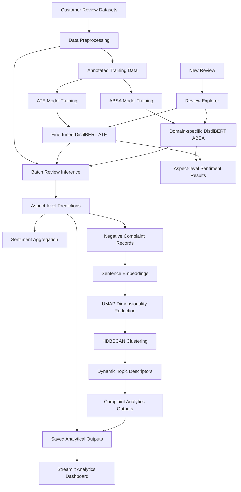

# SignalLens — Customer Feedback Intelligence Platform

**Turn unstructured customer reviews into structured, aspect-level intelligence.**

[](https://signallenss.streamlit.app/)
[](https://www.python.org/)
[](https://huggingface.co/)
[](https://pytorch.org/)
[](LICENSE)

**Live Application:** https://signallenss.streamlit.app/
**Source Code:** https://github.com/goelanuj371/SignalLens
**Trained Models:** https://huggingface.co/Shadow371/signallens-models

---

## 1. Overview

Customer reviews contain valuable information about product quality, service experience, usability, pricing and customer satisfaction. However, traditional sentiment analysis typically assigns a single sentiment label to an entire review, overlooking the fact that a customer can express different opinions about multiple aspects in the same sentence.

For example:

> "The battery life is excellent, but the keyboard is uncomfortable and the screen quality is disappointing."

A conventional sentiment classifier might label this review as negative or mixed. SignalLens goes further by identifying individual aspects and determining the sentiment associated with each one.

SignalLens is an end-to-end NLP-based customer feedback intelligence platform that combines:

- **Aspect Term Extraction (ATE):** Identifies specific product or service attributes mentioned in customer reviews.
- **Aspect-Based Sentiment Analysis (ABSA):** Determines the sentiment expressed toward each extracted aspect.
- **Unsupervised Complaint Discovery:** Groups negative feedback into recurring themes using semantic embeddings and density-based clustering.
- **Interactive Analytics Dashboard:** Presents sentiment distributions, problematic aspects, discovered complaint themes and individual review analysis.

The platform currently supports two supervised analysis domains: **Laptop** and **Restaurant**.

### Live Demo

Explore the deployed application:

**[Open SignalLens Dashboard](https://signallenss.streamlit.app/)**

The dashboard contains four sections:

| Section | Functionality |
|---|---|
| Overview | High-level customer feedback statistics and sentiment distribution |
| Aspect Intelligence | Aspect-level sentiment breakdown and problematic attributes |
| Complaint Discovery | Explore automatically discovered complaint clusters |
| Review Explorer | Submit individual reviews for live aspect extraction and sentiment classification |

---

## 2. System Architecture

SignalLens separates offline batch analytics from online review inference.

This allows computationally intensive complaint discovery and dataset processing to be performed independently of the interactive application.

### Architecture Overview



### Two execution workflows

**A. Offline batch analytics**

The batch pipeline processes the review datasets, generates aspect-level predictions, aggregates sentiment and discovers recurring complaint themes.

The resulting CSV files and embedding artifacts are saved and used by the dashboard.

**B. Live review inference**

When a user submits a review through Review Explorer:

1. The ATE model extracts aspect terms.
2. The selected domain-specific ABSA model classifies sentiment toward each extracted aspect.
3. The application displays the predicted sentiment, confidence and class probabilities.

The transformer models are loaded lazily, meaning the dashboard does not need to load them when users are exploring the precomputed analytics.

---

## 3. Machine Learning Approach

### 3.1 Aspect Term Extraction (ATE)

**Objective:** Identify the specific attributes or aspects mentioned in a review.

SignalLens uses a fine-tuned **DistilBERT token-classification model**.

The task is formulated as sequence labelling using the BIO tagging scheme:

| Label | Meaning |
|---|---|
| O | Token does not belong to an aspect |
| B-ASPECT | Beginning of an aspect |
| I-ASPECT | Continuation of an aspect |

Example:

```text
Review:
"The battery life is excellent."

Token          Label
The            O
battery        B-ASPECT
life           I-ASPECT
is             O
excellent      O
```

The model uses token-level classification to predict aspect boundaries and reconstruct extracted aspect terms.

**Training configuration:**

- Base model: `distilbert/distilbert-base-uncased`
- Task: Token classification
- Maximum sequence length: 128
- Training epochs: 3
- Learning rate: 2e-5
- Weight decay: 0.01
- Optimizer: AdamW
- Loss: Cross-entropy with ignored padding labels
- Gradient clipping: 1.0

### 3.2 Aspect-Based Sentiment Analysis (ABSA)

**Objective:** Determine the sentiment associated with a particular aspect rather than assigning one sentiment to the entire review.

SignalLens uses separate fine-tuned DistilBERT sequence-classification models for the Laptop and Restaurant domains.

The input is structured as a sentence-aspect pair:

```text
Sentence: The battery life is excellent, but the keyboard is terrible.

Aspect: battery life
Prediction: Positive

Aspect: keyboard
Prediction: Negative
```

The model receives the sentence and target aspect as paired inputs:

```text
[CLS] Sentence [SEP] Aspect [SEP]
```

The classifier predicts one of four sentiment classes:

| Class ID | Sentiment |
|---|---|
| 0 | Positive |
| 1 | Negative |
| 2 | Neutral |
| 3 | Conflict |

**Training configuration:**

- Base model: `distilbert/distilbert-base-uncased`
- Task: Sequence classification
- Separate models for Laptop and Restaurant
- Maximum sequence length: 128
- Training epochs: 3
- Learning rate: 2e-5
- Weight decay: 0.01
- Optimizer: AdamW
- Loss: Class-weighted cross-entropy
- Gradient clipping: 1.0

Class-weighted loss was used to account for differences in sentiment-class frequencies.

### 3.3 Unsupervised Complaint Discovery

**Objective:** Discover recurring patterns in negative customer feedback without requiring manually defined complaint categories.

This stage combines sentence embeddings, dimensionality reduction and density-based clustering.

**Step 1 — Negative feedback extraction**

The system selects negative aspect-level predictions and constructs complaint records containing the relevant aspect and review text.

**Step 2 — Semantic embeddings**

The pretrained model:

`sentence-transformers/all-MiniLM-L6-v2`

generates 384-dimensional semantic embeddings.

These embeddings represent the meaning of complaint records rather than relying only on keyword overlap.

**Step 3 — Dimensionality reduction**

UMAP reduces the embedding dimensions before clustering.

Configuration:

- Number of neighbors: 10
- Components: 5
- Minimum distance: 0
- Metric: Cosine
- Random state: 42

**Step 4 — Density-based clustering**

HDBSCAN identifies groups of semantically similar complaints.

Configuration:

- Minimum cluster size: 5
- Minimum samples: 2
- Metric: Euclidean
- Cluster selection method: EOM

Unlike fixed-centroid clustering approaches, HDBSCAN can identify clusters of varying density and leave unsuitable observations unassigned as noise.

**Step 5 — Dynamic topic descriptors**

Each discovered cluster is described using:

- YAKE keyword extraction
- Recurring aspect terms
- Redundancy filtering
- Representative customer reviews

The resulting topic descriptors are generated dynamically rather than relying on predefined complaint categories.

**Step 6 — Topic quality assessment**

The system generates heuristic quality indicators using:

- Unique review ratio
- Average pairwise cosine similarity
- Number of unique reviews

Topics are assigned one of the following flags:

- `strong_candidate`
- `needs_review`
- `low_evidence`

These flags are intended to assist inspection, not to establish independently validated topic coherence.

---

## 4. Datasets

SignalLens was developed using the **SemEval-2014 Task 4: Aspect Based Sentiment Analysis** dataset.

The experiments use two domains:

1. Laptop reviews
2. Restaurant reviews

The dataset contains sentence-level aspect annotations and sentiment labels, making it suitable for training both aspect extraction and aspect sentiment classification models.

### Dataset source

[SemEval2014Task4 — Hugging Face Dataset Mirror](https://huggingface.co/datasets/alexcadillon/SemEval2014Task4/tree/main)

### Dataset statistics

| Dataset | Training sentences | Training aspect annotations | Test sentences | Test aspect annotations |
|---|---:|---:|---:|---:|
| Laptop | 3,045 | 2,358 | 800 | 654 |
| Restaurant | 3,041 | 3,693 | 800 | 1,134 |

The training data also contains reviews without annotated aspect terms, which are useful for training the BIO sequence-labeling model.

### Data preprocessing

The preprocessing pipeline includes:

- Parsing the original XML annotations.
- Extracting sentences, aspect terms, offsets and sentiment labels.
- Converting aspect offsets into BIO token labels for ATE.
- Preparing sentence-aspect pairs for ABSA.
- Handling subword tokenization and offset alignment.
- Creating grouped training and validation splits.
- Removing identified exact sentence overlaps from ABSA training data.

The ATE evaluation retained two exact sentence overlaps between its training and official test sets. Consequently, the reported ATE results should be interpreted as leakage-reduced rather than fully independent evaluation.

---

## 5. Model Evaluation

The supervised models were evaluated using held-out test data.

### 5.1 Aspect Term Extraction

| Metric | Score |
|---|---:|
| Precision | 0.8026 |
| Recall | 0.8421 |
| Span-level F1 | **0.8219** |

The model achieved different results across domains:

| Domain | Span F1 |
|---|---:|
| Laptop | 0.7753 |
| Restaurant | 0.8483 |

### 5.2 Aspect-Based Sentiment Analysis

The fine-tuned models were compared against TF-IDF and Logistic Regression baselines.

| Model | Domain | Macro-F1 |
|---|---|---:|
| TF-IDF + Logistic Regression | Laptop | 0.5142 |
| Fine-tuned DistilBERT | Laptop | **0.6379** |
| TF-IDF + Logistic Regression | Restaurant | 0.5363 |
| Fine-tuned DistilBERT | Restaurant | **0.6157** |

Additional test metrics:

| Metric | Laptop | Restaurant |
|---|---:|---:|
| Accuracy | 0.7431 | 0.8025 |
| Macro-F1 | 0.6379 | 0.6157 |

### 5.3 End-to-end evaluation

The complete pipeline was evaluated by combining aspect extraction and sentiment classification.

| Metric | Score |
|---|---:|
| Aspect extraction precision | 0.8026 |
| Aspect extraction recall | 0.8421 |
| Aspect extraction F1 | 0.8219 |
| Sentiment accuracy on matched aspect spans | 0.7846 |
| Strict end-to-end precision | 0.6297 |
| Strict end-to-end recall | 0.6607 |
| Strict end-to-end F1 | **0.6448** |

Strict end-to-end evaluation requires both the aspect span and its sentiment prediction to be correct.

### Evaluation notes

- The conflict sentiment class has relatively low F1 performance and remains challenging because of its limited representation.
- ATE performance varies between domains and aspect-boundary patterns.
- End-to-end performance is lower than standalone ATE and ABSA performance because extraction errors propagate into sentiment analysis.
- The supervised models were trained and evaluated on Laptop and Restaurant SemEval data; performance on unrelated domains has not been established.

---

## 6. Batch Analytics Results

The batch pipeline processed **1,598 reviews**:

- 799 Laptop reviews
- 799 Restaurant reviews

The pipeline generated:

- 1,874 predicted aspect mentions.
- 954 aspect-domain combinations.
- 325 negative aspect-level complaint records.
- 26 discovered complaint clusters.
- 56 observations assigned to the HDBSCAN noise category.

The complaint discovery stage used negative aspect-level predictions as its input.

The resulting clusters represent recurring patterns in the processed feedback. Their descriptors are automatically generated and should be treated as candidate themes rather than manually validated business categories.

---

## 7. Using SignalLens with Other Datasets

SignalLens is designed around reusable NLP components, so the architecture can be adapted to other review datasets.

However, supporting a new dataset is not simply a matter of uploading a CSV file. The dataset must first be converted into the formats expected by the supervised models and batch pipeline.

### Option A — Adapting the supervised models

For ATE and ABSA, a new domain requires appropriately annotated training data.

The required information is:

| Field | Purpose |
|---|---|
| Sentence / Review | Original customer feedback |
| Aspect Term | Attribute mentioned in the review |
| Start Offset | Beginning character position of the aspect |
| End Offset | Ending character position of the aspect |
| Polarity | Sentiment associated with the aspect |

The preprocessing pipeline can then be adapted to:

1. Parse the new dataset.
2. Convert aspect annotations into BIO labels.
3. Prepare sentence-aspect pairs.
4. Map sentiment labels to the four supported classes, or modify the classifier for a different label set.
5. Fine-tune the ATE and ABSA models on the new domain.
6. Evaluate the models using domain-appropriate held-out data.

For example, an electronics, mobile-phone, hotel or e-commerce review dataset could be used after adapting its annotations and training pipeline.

### Option B — Adapting complaint discovery

The unsupervised complaint discovery component is more flexible.

A new dataset can be processed by:

1. Converting its reviews into the expected review-record format.
2. Running aspect extraction and sentiment inference using suitable domain models.
3. Selecting negative aspect-level feedback.
4. Generating semantic embeddings.
5. Running UMAP and HDBSCAN.
6. Generating topic descriptors and quality indicators.

This component does not require manually annotated complaint-topic labels.

However, its usefulness still depends on the quality of the input reviews and aspect-level predictions.

### Important distinction

The current application includes trained Laptop and Restaurant supervised models. Supporting a new domain requires training or fine-tuning suitable domain models and updating the application configuration and domain selection.

The underlying architecture is reusable, but cross-domain generalization should not be assumed.

---

## 8. Technology Stack

| Component | Technology |
|---|---|
| Programming language | Python |
| Deep learning | PyTorch |
| Transformer models | Hugging Face Transformers |
| ATE and ABSA architecture | DistilBERT |
| Semantic embeddings | Sentence Transformers |
| Dimensionality reduction | UMAP |
| Clustering | HDBSCAN |
| Keyword extraction | YAKE |
| Data processing | Pandas, NumPy |
| Classical ML baselines | Scikit-learn |
| Dashboard | Streamlit |
| Model hosting | Hugging Face Hub |
| Source control | Git and GitHub |
| Deployment | Streamlit Community Cloud |

### CPU-friendly inference

The deployed application performs transformer inference on CPU.

The models are hosted separately on Hugging Face and downloaded when required. This keeps the large model weights out of the GitHub source repository.

The dashboard also uses lazy model loading, so users exploring precomputed analytics do not need to wait for all transformer models to initialize.

The first Review Explorer request may take longer because model files need to be downloaded and loaded.

---

## 9. Project Structure

```text
SignalLens/
│
├── dashboard/
│   └── app.py
│
├── src/
│   └── signallens/
│       ├── data/
│       ├── evaluation/
│       ├── models/
│       │   ├── ate.py
│       │   └── absa.py
│       └── pipeline.py
│
├── notebooks/
│   └── SignalLens_ML_Pipeline.ipynb
│
├── outputs/
│   ├── aspect_level_predictions.csv
│   ├── review_level_predictions.csv
│   ├── aspect_sentiment_summary.csv
│   ├── problematic_aspects.csv
│   ├── negative_complaint_records.csv
│   ├── complaint_topic_assignments.csv
│   ├── complaint_topic_summary.csv
│   ├── topic_quality_report.csv
│   ├── final_topic_report.csv
│   └── negative_complaint_embeddings.npy
│
├── configs/
├── tests/
├── requirements.txt
├── .gitignore
└── README.md
```

The trained model weights are hosted separately:

[Hugging Face — SignalLens Models](https://huggingface.co/Shadow371/signallens-models)

When the models are not available in the local `models/` directory, the inference classes download the required model files from Hugging Face automatically.

---

## 10. Run Locally

### Prerequisites

- Python 3.12 or compatible Python version
- Git
- Internet connection for downloading the trained models

### Step 1 — Clone the repository

```bash
git clone https://github.com/goelanuj371/SignalLens.git
cd SignalLens
```

### Step 2 — Create a virtual environment

Windows:

```powershell
python -m venv .venv
.venv\Scripts\activate
```

Linux / macOS:

```bash
python -m venv .venv
source .venv/bin/activate
```

### Step 3 — Install dependencies

```bash
python -m pip install --upgrade pip
pip install -r requirements.txt
```

### Step 4 — Launch the dashboard

```bash
streamlit run dashboard/app.py
```

The dashboard will be available at the local URL displayed in the terminal, usually:

```text
http://localhost:8501
```

### Step 5 — Run live inference

1. Open Review Explorer.
2. Select Laptop or Restaurant.
3. Enter a customer review.
4. Click Analyse Review.
5. View extracted aspects, predicted sentiments and class probabilities.

The required models will be downloaded from Hugging Face on the first inference request if they are not already available locally.

---

## 11. Limitations and Future Improvements

SignalLens demonstrates an end-to-end approach to customer feedback intelligence, but several limitations remain.

- **Domain coverage:** Supervised ATE and ABSA models currently support Laptop and Restaurant domains.
- **Sentiment imbalance:** The conflict class has comparatively weaker predictive performance.
- **Aspect extraction:** Fragmented or ambiguous aspect expressions can be challenging to identify.
- **Topic discovery:** HDBSCAN may assign observations to noise, and some discovered clusters contain limited independent review evidence.
- **Topic quality:** Quality indicators are heuristic and are not a substitute for human validation.
- **Evaluation:** The ATE test set contains two exact sentence overlaps with training data, so its evaluation is not fully independent.
- **Inference latency:** CPU-based transformer inference is slower than GPU inference, particularly during initial model loading.

Potential future improvements include:

- Expanding supervised support to additional review domains.
- Improving minority-class sentiment prediction.
- Evaluating topic quality using additional coherence and human-review measures.
- Adding model monitoring and feedback-based retraining.
- Exploring multilingual aspect extraction and sentiment classification.
- Optimizing inference latency and model caching.

---

## 12. Acknowledgements and References

This project builds on publicly available research datasets and open-source machine learning libraries.

- [SemEval-2014 Task 4: Aspect Based Sentiment Analysis](https://huggingface.co/datasets/alexcadillon/SemEval2014Task4/tree/main)
- [DistilBERT](https://huggingface.co/distilbert/distilbert-base-uncased)
- [Sentence Transformers — all-MiniLM-L6-v2](https://huggingface.co/sentence-transformers/all-MiniLM-L6-v2)
- [Hugging Face Transformers](https://github.com/huggingface/transformers)
- [PyTorch](https://pytorch.org/)
- [UMAP](https://umap-learn.readthedocs.io/)
- [HDBSCAN](https://hdbscan.readthedocs.io/)
- [YAKE](https://github.com/INESCTEC/yake)

---

## 13. Author

**Anuj Goel**

- GitHub: [@goelanuj371](https://github.com/goelanuj371)
- Project Repository: [SignalLens](https://github.com/goelanuj371/SignalLens)
- Live Application: [SignalLens Dashboard](https://signallenss.streamlit.app/)

---

**SignalLens — From customer reviews to actionable intelligence.**